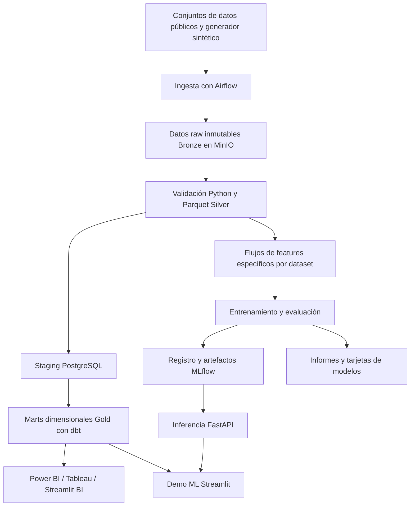

# InsureIQ — Plataforma de análisis de riesgos y fraudes en seguros

**Versión:** 1.0 | **Estado:** Especificación de implementación | **Objetivo:** Portafolio de científico de datos, sector asegurador | **Repositorio:** `insureiq-data-science-platform`

## 1. Mandato del agente

Implementar un proyecto de portafolio funcional y de extremo a extremo, no un andamiaje ni una colección de pantallas simuladas. Trabajar de forma incremental, ejecutar pruebas, inspeccionar resultados y registrar los resultados reales. Todo el código fuente debe estar en ingles, pero comentarios del código, identificadores, interfaz de usuario, documentación y mensajes de commit deben estar en español y los mensaje del commit debe seguir este formato: yyyymmdd y mensaje bastante descriptivo de lo hecho en el commit, para esto es una regla obligatoria siempre revisar la fecha antes de hacer commit para colocar la fecha correcta. Se puede proporcionar opcionalmente un resumen ejecutivo en español. Ubuntu es el único sistema operativo de desarrollo requerido; no exigir Windows, Wine, Power BI Desktop ni Tableau Desktop. Usar flujos de trabajo compatibles con la terminal. Nunca inventar métricas, capturas de pantalla, implementaciones exitosas, credenciales ni procedencia de conjuntos de datos. No reemplazar silenciosamente las tecnologías solicitadas. Registrar bloqueos y alternativas en `docs/implementation-status.md`. Consultar al propietario antes de usar recursos pagos, publicar públicamente o cambiar permisos de cuentas. No confirmar secretos. Tratar esta especificación como la fuente de verdad y documentar las desviaciones en ADR. Implementar cada fase antes de avanzar; las implementaciones de marcador de posición no cuentan como completas.

## 2. Visión y alcance del producto

Construir una plataforma analítica para una aseguradora ficticia ecuatoriana de vehículos. Demostrar Python, SQL, estadística, aprendizaje automático, limpieza de datos, análisis, visualización, Power BI, Tableau y recomendaciones empresariales accionables, además de preparación para el despliegue en Azure. Usuarios principales: ejecutivo, analista de riesgos, investigador de fraude, científico de datos y reclutador. Esta es una demostración de apoyo a decisiones, no un sistema de suscripción productivo, un cálculo certificado de reservas actuariales ni un sistema automático de rechazo de siniestros. No usar información personal real. El USD es la moneda de reporte de la aseguradora ficticia; los conjuntos de datos externos reales conservan sus unidades y geografía nativas. No convertir monedas salvo que se documente explícitamente.

### Preguntas de negocio
- ¿Qué siniestros merecen investigación manual de fraude dada la capacidad limitada de los investigadores?
- ¿Cuál es la frecuencia y severidad esperadas de siniestros y la pérdida anual por exposición de póliza?
- ¿Qué carteras tienen índices de siniestralidad y combinados desfavorables, y por qué?
- ¿Cómo podrían evolucionar el volumen mensual y los costos de siniestros, incluida la incertidumbre?
- ¿Qué hallazgos respaldan acciones operativas y cuáles son solamente asociaciones?

### Entregables
ETL reproducible, almacén dimensional, notebooks estadísticos, modelos entrenados y evaluados, tarjetas de modelos, API, demo interactiva de Streamlit, informes de Power BI, libros de Tableau Public, definiciones de fuentes de BI, pruebas, informe ejecutivo, capturas de resultados reales, instrucciones de despliegue y un README amigable para reclutadores. Priorizar la evidencia del razonamiento científico por encima de la complejidad de infraestructura.

## 3. Arquitectura y stack



Usar Python 3.11 o 3.12 después de verificar compatibilidad, PostgreSQL, almacenamiento de objetos compatible con MinIO/S3, Parquet/PyArrow, Airflow, dbt Core + adaptador de postgres, pandas, NumPy, SciPy, statsmodels, scikit-learn, XGBoost, LightGBM, SHAP, Prophet (opcional si falla la instalación, documentarlo), JupyterLab, MLflow, FastAPI/Pydantic, Streamlit/Plotly, Ruff, pytest, GitHub Actions y Docker Compose v2. Fijar versiones compatibles y confirmar un lockfile (preferir uv). Todo el código Python, notebooks y comandos Python deben ejecutarse dentro de contenedores con la versión fijada por el proyecto; no depender de la versión de Python instalada por quien haga un fork. Usar un monolito modular para el código Python y contenedores separados para servicios. Evitar Kubernetes, Kafka, Redis y dependencias pagas salvo justificación y aprobación. Usar perfiles Compose `core`, `orchestration`, `mlops`, `demo` para que una laptop pueda ejecutar subconjuntos. El binding local debe usar loopback por defecto; no exponer bases de datos ni MLflow públicos sin autenticación. Proporcionar healthchecks, volúmenes persistentes, inicialización, políticas de reintento, orientación de recursos y `.env.example`. Preferir UTC internamente y mostrar hora de Ecuador (`America/Guayaquil`) cuando corresponda.

## 4. Fuentes de datos y procedencia

| Fuente | Propósito | Tratamiento requerido |
|---|---|---|
| OpenML freMTPL2freq (responsabilidad civil automotriz francesa; comúnmente dataset 41214) | Exposición y frecuencia de siniestros | Verificar identificador, versión, licencia, columnas y unidades antes de ingerir |
| OpenML freMTPL2sev (severidad de siniestros positivos; comúnmente 41215) | Severidad de siniestros | Verificar identificador, clave de unión y multiplicidad; no asumir una fila por póliza |
| Dataset público de fraude de seguros vehiculares (por ejemplo `fraud_oracle.csv` / Vehicle Insurance Fraud Detection) | Benchmark supervisado de fraude | Verificar fuente original, licencia, semántica del objetivo y redistribución permitida; usar instrucciones de descarga manual si requiere autenticación |
| Aseguradora ecuatoriana ficticia con semilla | Almacén, BI, pronóstico de escenarios y demo | Etiquetas sintéticas explícitas y documentación del generador |

Enlaces oficiales de descubrimiento: https://www.openml.org/ ; https://www.kaggle.com/datasets . No hacer scraping detrás de autenticación ni evadir términos. `data/sources.yml` debe contener URL exacta resuelta, versión del dataset, licencia, atribución, fecha de recuperación, SHA256, esquema, cantidad de filas, geografía, moneda, definición del objetivo y política de redistribución. Excluir archivos raw de Git salvo permiso explícito. Proporcionar `make data-fetch` e instrucciones de colocación manual; fallar claramente si no están disponibles. Un fallback sintético puede ejecutar el pipeline, pero no reemplaza la evidencia de benchmarks reales. No unir datasets públicos de fraude y franceses no relacionados en historiales ficticios de clientes. Conservar `source_dataset`, `is_synthetic`, `run_id` y procedencia en las salidas. No presentar resultados franceses como estimaciones de riesgo ecuatorianas validadas.

### Generador sintético

Generador determinista, configurable y con semilla usando Faker/NumPy. El perfil completo apunta a 100.000 clientes, 120.000 vehículos, 250.000 pólizas históricas, 50.000 siniestros y 2.000.000 de transacciones financieras durante cinco años completos (2021–2025 por defecto); el perfil smoke debe ser aproximadamente 1 %, con relaciones coherentes. Incluir, cuando sea práctico, las 24 provincias de Ecuador, segmentos urbanos/rurales, estacionalidad, renovaciones, desarrollo de siniestros, pagos, gastos, efectos de talleres y agentes, etiquetas de fraude poco frecuentes y faltantes/duplicados realistas en los fixtures raw. Usar IDs y nombres ficticios, sin direcciones reales ni números de identidad. Documentar distribuciones, supuestos, generación de etiquetas y anomalías inyectadas. Evitar reglas de fraude trivialmente deterministas y no filtrar variables ocultas del generador en las features. Preservar la integridad referencial después de limpiar y usar generación por chunks. Separar la variabilidad legítima del negocio de los registros corrompidos deliberadamente. El pronóstico simulado es una demostración, no evidencia de validez predictiva en el mundo real.

## 5. Contratos de datos y almacén

Usar los esquemas `raw`, `staging`, `silver`, `gold` y `audit` según corresponda; particionar las rutas de objetos Bronze/Silver por fuente y fecha de ingesta. Bronze es inmutable, Silver está tipado y deduplicado, y Gold es dimensional. Usar claves sustitutas y claves naturales; SCD2 para cambios materiales de cliente/póliza cuando esté justificado. Campos monetarios `numeric(18,2)`; timestamps con zona horaria; fechas ISO; exposición no negativa; fila de dimensión desconocida explícita. No usar punto flotante para conciliaciones financieras.

| Tabla | Granularidad / clave | Campos esenciales |
|---|---|---|
| dim_date | fecha calendario | año, mes, trimestre, semana |
| dim_customer | versión del cliente | customer_id, age_band, province, tenure, valid_from/to |
| dim_vehicle | versión del vehículo | vehicle_id, make, model, year, value, usage |
| dim_policy | versión de la póliza | policy_id, product, coverage, deductible, limit, fechas de vigencia |
| dim_workshop | taller | workshop_id, province, category |
| dim_agent | agente | agent_id, region, channel |
| dim_geography | provincia/cantón | códigos, nombres, claves geográficas verificadas |
| fact_policy_exposure | póliza-mes | policy_key, customer_key, vehicle_key, exposure_days, earned_premium, written_premium |
| fact_claim | siniestro | claim_id, policy_key, loss_date, report_date, type, claimed_amount, status |
| fact_claim_snapshot | siniestro-mes | paid_to_date, outstanding_estimate, incurred_to_date, as_of_date |
| fact_payment | transacción financiera | transaction_id, clave de póliza/siniestro, fecha, tipo, monto firmado, moneda |
| fact_expense | transacción de gasto | expense_id, fecha, categoría, base de asignación, monto |
| fact_fraud_review | investigación | claim_id, review_date, outcome, label_available_at |
| fact_model_score | entidad/modelo/fecha de corte | score, model_version, feature_snapshot_id, threshold, source_dataset |
| fact_forecast | serie/objetivo/mes/modelo/fecha de corte | point, lower, upper, horizon, model_version |

Usar cardinalidades explícitas, restricciones FK/unique/check e índices sobre fechas, claves de negocio y columnas de unión. Evitar fan-out entre siniestros, pagos y exposición. Crear los marts `mart_executive_monthly`, `mart_portfolio_profitability`, `mart_claims_risk`, `mart_fraud_review`, `mart_geographic_risk`, `mart_forecast`, `mart_model_performance`. Incluir ejemplos SQL de funciones de ventana, CTE, retención por cohortes, índices móviles, ranking, percentiles y conciliación; incluir EXPLAIN ANALYZE para consultas representativas y evidencia medida de optimización. Documentar granularidad y definiciones de métricas en YAML de dbt y en el diccionario de datos.

## 6. ETL y calidad

DAGs de Airflow: `ingest_public`, `generate_synthetic`, `validate_transform`, `build_warehouse`, `train_models`, `score_and_export_bi`. Definir dependencias explícitas, reintentos con backoff, timeouts, upserts idempotentes, watermark/checkpoint, backfill y rerun manual. No entrenar en cada ingesta por defecto; el entrenamiento debe activarse explícitamente o programarse por separado. Usar transacciones y staging swap/merge; una falla no debe exponer Gold parcialmente actualizado. Auditar run ID, hash de fuente, cantidades de entrada/salida/rechazo, duración, estado y error. Poner registros inválidos en cuarentena con códigos de motivo; nunca descartarlos silenciosamente. Probar esquema, nulos, unicidad, integridad FK, orden de fechas, montos no negativos cuando corresponda, rangos de exposición, eventos duplicados, conciliación y frescura de fuentes. Documentar excepciones (reversiones, reapertura de siniestros y cancelaciones). Reproducir una entrada idéntica no debe cambiar cantidades ni totales. Proporcionar fixtures deterministas e informe de calidad. Evitar ajustar imputadores/escaladores con todos los datos; las transformaciones de ML se ajustan solamente dentro del split de entrenamiento.

## 7. Reglas de negocio y contratos de KPI

- Prima devengada: prorratear la prima elegible durante los días de cobertura del período informado; manejar explícitamente cancelaciones y endosos. La prima emitida no es prima devengada. Años de exposición = días cubiertos / 365,25 (documentar la convención); no contar dos veces versiones superpuestas.
- Frecuencia de siniestros = cantidad de siniestros / años de exposición; severidad = costo de siniestros incurrido elegible / cantidad de siniestros. Definir inclusión de siniestros y tratamiento de costo cero. Pérdida anual esperada = frecuencia anual esperada × severidad media condicional, no probabilidad de al menos un siniestro × severidad cuando puede haber varios siniestros.
- Siniestros incurridos = pagos acumulados + estimación pendiente en una fecha de corte consistente; movimiento de siniestros incurridos del período = cambio del incurrido acumulado, incluidos siniestros nuevos. No sumar snapshots acumulados entre meses. Distinguir flujo de caja pagado de costo incurrido.
- Índice de siniestralidad = pérdidas incurridas / prima devengada; índice de gastos = gastos de suscripción asignados / prima devengada; índice combinado = suma de ambos índices; resultado técnico = prima devengada menos pérdidas incurridas y gastos de suscripción. Usar una base bruta/neta consistente, bruta por defecto. Un denominador cero produce null/N/A, no un cero engañoso.
- Tasa de fraude confirmado = siniestros fraudulentos confirmados / siniestros con resultado de fraude resuelto; informar por separado cobertura de revisión y tasa de scores sospechosos. Las revisiones pendientes no son etiquetas negativas. Un score no demuestra fraude.
- Pronosticar liquidez usando montos pagados, no costos incurridos; etiquetar la incertidumbre del pronóstico. No afirmar reservas certificadas.
- Todas las herramientas BI usan definiciones Gold compartidas; comparar totales entre herramientas usando fixtures dorados. Mostrar filtros de fecha, moneda, fuente y metadatos de fecha de corte. Los dashboards públicos contienen solamente datos públicos aprobados o sintéticos.

## 8. Flujo científico y análisis estadístico

Cada notebook debe ejecutarse desde un entorno limpio con rutas de datos y semilla parametrizadas; la lógica reutilizable pertenece a `src`, no solamente a notebooks. Incluir hipótesis, método, supuestos, resultados, tamaños de efecto, incertidumbre, limitaciones e interpretación empresarial. Exportar resúmenes y gráficos en HTML o Markdown. No inventar conclusiones.

EDA requerida: faltantes, duplicados, prevalencia del objetivo, distribución de exposición, asimetría, cuantiles, outliers (IQR y Z-score cuando corresponda), tendencias temporales, geografía, desbalance de clases, correlaciones (Pearson/Spearman), auditoría de leakage y disponibilidad de features. Pruebas estadísticas: chi-cuadrado con verificación de celdas esperadas (Fisher cuando corresponda), ANOVA con verificación de supuestos o alternativas Welch/Kruskal-Wallis, intervalos de confianza (bootstrap cuando corresponda), corrección por pruebas múltiples (Benjamini-Hochberg), tamaños de efecto y tamaños de muestra. Distinguir asociación de causalidad. Evitar tratar observaciones repetidas de pólizas como independientes; usar bootstrap agrupado o modelos adecuados. Documentar por qué cada prueba es relevante; no ejecutar pruebas solamente para completar una lista.

## 9. Experimentos y evaluación de ML

### Protocolo común

Definir timestamp de predicción, objetivo, horizonte, población elegible, disponibilidad de features y split antes de modelar. Preferir splits cronológicos de train/validación/test cuando existan fechas confiables; de lo contrario, usar splits agrupados y estratificados cuando sea viable y documentar las limitaciones. Mantener juntos los registros relacionados de póliza/cliente cuando corresponda; evitar leakage entre joins de frecuencia/severidad. Ajustar preprocesamiento y remuestreo solamente dentro de folds de entrenamiento. Usar pipelines, semillas fijas, búsqueda de hiperparámetros acotada y test final intacto. Guardar manifiestos de splits, hashes de datos, configuración, entorno, métricas, gráficos y artefactos de modelos. Comparar con baselines simples; no prometer rendimiento arbitrario. Informar incertidumbre y tamaños de subgrupos. Si ningún modelo supera el baseline, informarlo y seleccionar el baseline cuando corresponda.

### 9.1 Detección de fraude

Usar como objetivo el fraude confirmado del benchmark público. Las features deben estar disponibles solamente al recibir el siniestro; excluir resultados de investigación, campos posteriores a la decisión y proxies del objetivo. Comparar regresión logística, random forest, XGBoost y LightGBM; Isolation Forest como experimento separado de ranking de anomalías (no como probabilidad de fraude calibrada). Manejar el desbalance con pesos de clase o remuestreo solamente en entrenamiento. Informar PR-AUC/average precision, ROC-AUC, precision, recall, F1, matriz de confusión, precision@K, recall@K, calibración/Brier score. Ajustar el umbral en validación usando capacidad de investigadores y supuestos ilustrativos de costos; incluir análisis de sensibilidad. Calibrar probabilidades cuando sea compatible. Explicaciones SHAP globales y locales; explicar limitaciones y ausencia de interpretación causal. Emitir la recomendación `MANUAL_REVIEW` o `STANDARD_REVIEW`; nunca rechazar automáticamente. Mostrar versión del modelo y fuente del score. Evaluar disparidades entre subgrupos cuando sea legal y relevante; evitar features sensibles o proxies en la demo operativa salvo justificación.

### 9.2 Frecuencia y severidad

Usar los datasets freMTPL2 por separado con una unión de pólizas verificada. Frecuencia: GLM Poisson consciente de la exposición con offset logarítmico de exposición, binomial negativa si hay sobredispersión y challenger basado en árboles con tratamiento adecuado de la exposición. Baseline de tasa de siniestros de la cartera. Informar deviance de Poisson, MAE, calibración por decil de exposición/riesgo y totales observados/predichos. Severidad: montos positivos de siniestros, GLM Gamma con enlace log y challenger XGBoost; informar MAE, RMSE, deviance Gamma cuando sea válida, diagnósticos de residuos y sensibilidad de cola. Dividir por póliza, no por fila de siniestro. Prima pura: frecuencia × severidad; comparar un modelo Tweedie cuando la construcción del objetivo lo permita; evaluar deviance ponderada por exposición y calibración. Explicar supuestos e incertidumbre. No afirmar validación ecuatoriana.

### 9.3 Pronóstico

Usar cantidades mensuales de siniestros, movimientos incurridos y montos pagados de historia sintética o series públicas adecuadas y verificadas. Baselines: último valor y naive estacional; comparar ARIMA/SARIMA y Prophet cuando sea viable. Backtests de origen móvil, horizontes de 1/3/6 meses, sin split aleatorio. Informar MAE, RMSE, WAPE cuando el denominador sea válido y cobertura de intervalos; evitar MAPE en series con ceros. Proporcionar intervalos de predicción de 80 %/95 % cuando estén respaldados y etiquetar la metodología. No confundir intervalos de confianza con intervalos de predicción. Mantener covariables futuras conocidas al momento de la predicción. Registrar quiebres estructurales y la naturaleza simulada.

### 9.4 MLOps

Usar tracking, almacenamiento de artefactos y registro de MLflow; tarjetas de modelos con uso previsto, fuente de entrenamiento, métricas, limitaciones, equidad, esquema de features, versión y estado de aprobación. Promover solamente después de una compuerta de evaluación explícita; no promover automáticamente a producción. Monitorear faltantes, cambios de esquema, PSI u otras métricas de drift justificadas, distribución de scores y rendimiento con etiquetas demoradas. El drift es una alerta, no un reentrenamiento automático. Proporcionar rollback al modelo anterior y scoring batch reproducible. No registrar información personal. Usar solamente artefactos de modelos locales confiables.

## 10. API y aplicación

Endpoints versionados de FastAPI: `GET /health`, `GET /ready`, `GET /api/v1/models`, `POST /api/v1/fraud/predict`, `POST /api/v1/risk/predict`, `GET /api/v1/forecasts`, `GET /api/v1/metrics`. Esquemas Pydantic, OpenAPI, tamaño de entrada/batch limitado, validación, errores estructurados, correlation ID, timeouts y verificaciones de disponibilidad del modelo. No permitir SQL arbitrario ni archivos de modelos ejecutables subidos. Devolver 422 para entrada inválida y 503 si el modelo no está disponible. La demo local es de solo lectura salvo predicción; un despliegue público debe limitar la tasa y autenticar operaciones administrativas. No exponer registros crudos de clientes.

Respuesta de ejemplo (ilustrativa, no medida):
```json
{"claim_id":"DEMO-001","fraud_probability":0.87,"recommendation":"MANUAL_REVIEW","model_version":"example","source_dataset":"public-benchmark","risk_factors":["example feature contribution"],"limitations":"Demonstration only"}
```
La salida de riesgo incluye cantidad anual esperada de siniestros, severidad condicional, pérdida anual esperada, unidades y fuente. No inventar límites de incertidumbre. Páginas de Streamlit: resumen ejecutivo, predicción de fraude con ejemplos válidos editables, comparación de modelos, explorador SHAP, riesgo/severidad, pronóstico y explorador estadístico. Distinguir KPI empresariales sintéticos de métricas reales del benchmark. Proporcionar estados de carga, error y vacío, labels accesibles, filtros consistentes, layout responsivo y exportación de resultados agregados. No se requiere un frontend Angular complejo.

## 11. BI como código — Solo Ubuntu

El propietario tiene una cuenta estudiantil web de Power BI y una cuenta personal de Tableau Public. La existencia de la cuenta no demuestra capacidad Fabric, permisos de API ni derechos de publicación pública. Realizar primero un capability spike y registrar resultados reales en `docs/bi-capabilities.md`. Nunca pedir contraseñas ni confirmar tokens. Usar login oficial OAuth/interactivo, variables de entorno y mínimo privilegio. Todo artefacto público requiere aprobación del propietario.

### 11.1 Contrato BI compartido

Exportar marts curados como CSV y Parquet con nombres estables de columnas, tipos, formatos de fecha, diccionario de métricas, cantidades de filas, hashes y etiquetas de fuente. Generar extracts pequeños para demo pública; no es necesario subir 2 millones de transacciones. Usar datos agregados o una fuente alojada aprobada de solo lectura. PostgreSQL local no es automáticamente accesible desde SaaS; no exponerlo a Internet ni exigir un gateway de Windows. Documentar estrategia de actualización (un snapshot manual es aceptable para el portafolio). Crear fixtures dorados de KPI y pruebas de conciliación entre herramientas. Mantener paleta consistente, contraste accesible, unidades claras, comportamiento de filtros y drill-down cuando esté disponible. Incluir capturas reales y enlaces de publicación solamente después de verificarlos.

### 11.2 Power BI

Informes/páginas requeridos: Resumen Ejecutivo de Seguros (prima devengada, pérdidas incurridas, índice de siniestralidad, índice combinado, pólizas activas y tendencias); Rendimiento Financiero (efectivo vs. incurrido, gastos y resultado técnico); Pronóstico de Siniestros (real/pronosticado, intervalos y horizonte); Rentabilidad de Cartera (producto, geografía, cohortes y exposición). Incluir medidas DAX, dimensión de fechas, relaciones, filtros y definiciones de tooltips. Usar definiciones de texto PBIP/PBIR JSON y TMDL cuando estén disponibles; versionar esquemas, validar JSON y referencias. Generar definiciones de modelo semántico e informes mediante APIs/skills oficiales de Fabric cuando corresponda. PBIP es un formato fuente, no un formato garantizado de carga en navegador. Usar APIs Fabric Create Item/Report con las partes de definición correctas y payload base64, vinculación del modelo semántico, permisos, workspace y requisitos de capacidad; manejar operaciones asíncronas, reintentos y errores. Nunca asumir que la API soporta cada artefacto ni que el tenant estudiantil lo permite. Probar un informe y modelo semántico mínimos antes de la generación completa. Usar la documentación oficial enlazada en la especificación original.

Si la publicación por API está bloqueada, generar extracts CSV, DAX, Power Query M, mapa de relaciones del modelo, JSON de tema, especificaciones de páginas/visuales e instrucciones exactas para autoría en navegador. El propietario puede completar manualmente la autoría web; no afirmar que un informe generado funciona sin abrirlo. Si la autoría o el uso compartido web está restringido, conservar la fuente, las capturas disponibles reales, documentar el bloqueo y proporcionar una vista pública equivalente en Streamlit. Publicar públicamente/Publish to web solamente si el tenant lo permite y el propietario lo aprueba; de lo contrario, un enlace privado no es una demo accesible para reclutadores. No realizar upgrades pagos sin aprobación.

### 11.3 Tableau Public

Dashboards requeridos: Analítica de Detección de Fraude (cola de revisión, bandas de score, tasa de fraude resuelto y métricas del modelo); Análisis Geográfico de Riesgo (límites verificados de provincias ecuatorianas o claves geográficas, frecuencia normalizada por exposición); Segmentación de Riesgo de Clientes (deciles de riesgo, exposición y calibración); Análisis de Severidad de Siniestros (distribución, cola, taller y tipo de siniestro). Generar extracts CSV y `.hyper` usando `tableauhyperapi` en Linux cuando sea compatible. Versionar campos calculados, layout del dashboard, diccionario de datos y definiciones de workbooks (`.twb`, `.twbx`) cuando sea viable. El XML de workbooks de Tableau no es una API de autoría garantizada: validar contra el comportamiento real de la plataforma; no inventar un esquema XML ni afirmar que un paquete no probado es válido. Publicar mediante REST/TSC de Tableau Cloud/Server no equivale a Tableau Public. No usar endpoints no documentados ni automatización de navegador que evada las reglas. Si Public no soporta la carga de workbooks generados, usar autoría web en navegador con CSV preparado e instrucciones exactas de visualizaciones/cálculos. El propietario realiza los pasos interactivos necesarios. Los datos/workbooks públicos pueden descargarse; usar solamente datos sintéticos o públicos aprobados. Verificar acceso anónimo a dashboards publicados.

### 11.4 Aceptación BI

Cada dashboard debe tener datos reales, filtros útiles, conciliación correcta de KPI, divulgación de fuente y un renderizado probado o un paso manual marcado explícitamente como pendiente. Un archivo JSON/XML por sí solo no demuestra que el informe funcione. Producir `dashboards/README.md` con pasos de construcción/publicación/actualización, capturas y estado de acceso. Proporcionar equivalentes públicos en Streamlit para páginas de Power BI inaccesibles. No afirmar dominio de Tableau o Power BI basándose solamente en archivos generados; documentar cómo el propietario puede explicar medidas y decisiones de diseño.

## 12. Estructura del repositorio

```text
insureiq-data-science-platform/
  .github/workflows/ci.yml
  .env.example
  .gitignore
  README.md
  SPEC.md
  LICENSE
  pyproject.toml
  uv.lock
  Makefile
  compose.yml
  configs/{smoke,full,models}.yml
  data/{sources.yml,README.md,raw,processed,synthetic}/
  airflow/dags/
  database/{schemas,migrations,queries}/
  dbt/{models,tests,seeds}/
  notebooks/01_data_quality.ipynb
  notebooks/02_exploratory_analysis.ipynb
  notebooks/03_statistical_analysis.ipynb
  notebooks/04_feature_engineering.ipynb
  notebooks/05_fraud_detection.ipynb
  notebooks/06_risk_prediction.ipynb
  notebooks/07_claim_severity.ipynb
  notebooks/08_financial_forecasting.ipynb
  src/insureiq/{ingestion,preprocessing,features,statistics,models,evaluation,monitoring,api,bi}/
  dashboards/powerbi/{project,themes,measures,scripts}/
  dashboards/tableau/{workbooks,datasources,calculations,scripts}/
  dashboards/streamlit/
  infrastructure/{docker,azure}/
  reports/{executive_summary,statistical_findings,model_evaluation,business_recommendations}.md
  reports/model_cards/
  tests/{unit,integration,data,api,bi}/
  docs/{architecture,data_dictionary,bi-capabilities,implementation-status,runbook}.md
  docs/adr/
  docs/screenshots/
```

Usar licencia MIT para el código original salvo que el propietario elija otra; las licencias de datasets se mantienen separadas. Ignorar secretos, datasets raw, volúmenes locales, cachés y artefactos grandes de modelos. Proporcionar checksums y generación reproducible en lugar de confirmar binarios grandes. Mantener notebooks legibles con outputs reales seleccionados o informes HTML generados.

## 13. Comandos de desarrollo

Implementar y documentar estos targets Make específicos del proyecto (no comandos nativos de proveedores):

```bash
make bootstrap        # instalar dependencias bloqueadas
make up               # servicios core
make smoke            # ejecución end-to-end pequeña
make data-fetch       # datasets públicos aprobados
make data-generate    # datos sintéticos configurables
make etl              # ingerir/validar/cargar
make dbt-build        # marts y pruebas
make notebooks        # ejecutar notebooks
make train            # todos los experimentos compatibles
make evaluate         # informes y tarjetas de modelos
make score            # scoring batch
make bi-data          # exportar marts compartidos
make powerbi-build
make powerbi-validate
make powerbi-deploy   # autenticación y confirmación explícitas
make tableau-extracts
make tableau-build
make bi-build
make streamlit
make test
make lint
make down
```

Proporcionar también `make doctor`, `make api`, `make forecast`, `make clean` (no destructivo por defecto) y un reset explícito y opt-in de volúmenes. Los comandos deben devolver un código distinto de cero ante fallos, imprimir diagnósticos accionables y funcionar desde un checkout limpio de Ubuntu. Documentar variables de entorno, puertos y ejemplos de invocación. No incluir credenciales en ejemplos del historial de comandos.

## 14. Azure y demo pública

Compose local es canónico y gratuito. Proporcionar arquitectura Azure y despliegue opcional mediante Bicep o Terraform: API/demo contenerizada, PostgreSQL flexible u otro almacenamiento administrado aprobado, Blob Storage, Key Vault y monitoreo. Explicar el mapeo de MinIO a Azure Blob (requiere un adaptador, no asumir compatibilidad S3), redes privadas, identidad administrada, secretos, backups y costos. Proporcionar plantillas parametrizadas, validación e instrucciones de teardown; no desplegar sin aprobación del propietario y estimación actual de costos. No afirmar capacidad gratuita de Azure. Para la demo de reclutadores, preferir Streamlit Community Cloud u otro host gratuito aprobado usando artefactos compactos saneados e inferencia de solo lectura; verificar límites de recursos, compatibilidad de dependencias y acceso anónimo. Si el despliegue no está disponible, proporcionar demo local y walkthrough grabado. No publicar endpoints de Airflow/MLflow/administración.

## 15. Pruebas, seguridad y rendimiento

Pruebas unitarias para métricas, exposición, snapshots financieros, leakage de features, lógica de splits, preprocesamiento, umbrales, generador determinista y serialización. Pruebas de integración para PostgreSQL/MinIO/dbt y API, idempotencia de reruns, cuarentena y rollback. Las pruebas BI con fixtures dorados comparan SQL, Python y medidas exportadas; validar esquemas y referencias PBIR cuando estén disponibles. Pruebas de API para entradas inválidas y modelos faltantes. CI en Ubuntu: lint/verificación de formato con Ruff, pytest, pruebas dbt contra una base de pruebas, smoke pipeline con fixtures pequeños, análisis de dependencias/seguridad y secret scan; no se requieren credenciales cloud para PR. Apuntar al menos a 80 % de cobertura de la lógica de negocio principal (no notebooks/archivos generados) e informar la cobertura real. Medir duración ETL, memoria máxima y latencia de inferencia en hardware documentado; no inventar afirmaciones de rendimiento. El perfil completo debe usar chunking y evitar cargar todas las transacciones financieras en memoria. Documentar cuellos de botella medidos. Fijar imágenes/dependencias; no usar credenciales públicas predeterminadas, secretos en logs ni PII real. La demo pública usa datos saneados y no permite carga arbitraria de archivos.

## 16. Fases de implementación y gates

| Fase | Esfuerzo objetivo (indicativo) | Evidencia de salida |
|---|---:|---|
| 0: capability spike | 1 día | verificación de dependencias Ubuntu, checklist de capacidades de cuentas Power BI/Tableau y licencias de datasets |
| 1: base y datos | 2 días | Compose, generador, ingesta pública, almacén, pruebas dbt y smoke reproducible |
| 2: estadística | 2 días | notebooks EDA/estadísticos ejecutados y hallazgos |
| 3: fraude | 2 días | baselines/challengers, evaluación holdout, umbral y SHAP, tarjeta de modelo |
| 4: riesgo/severidad | 2 días | modelos conscientes de exposición, calibración y evaluación de prima pura |
| 5: pronóstico | 1 día | backtest móvil, comparación con baseline e intervalos |
| 6: BI | 2 días | exports compartidos, fuentes Power BI/Tableau e informes verificados o bloqueos manuales explícitos |
| 7: API/MLOps/demo | 2 días | inferencia probada, Streamlit y reporte de drift |
| 8: entrega | 2 días | CI verde, capturas reales, informe ejecutivo, plan Azure, README y demo |

Aproximadamente 16 días enfocados, no un cronograma garantizado. MVP de la primera semana: datos reproducibles, marts SQL, hallazgos estadísticos, benchmark de fraude y un dashboard visible. Mantener el alcance completo, pero priorizar evidencia visible para reclutadores. En cada gate actualizar el estado de implementación con trabajo completado, comandos ejecutados, resultados reales, problemas pendientes y próximos pasos. Hacer commits de incrementos coherentes; no hacer push ni publicar sin autorización del propietario.

## 17. Presentación para reclutadores

README visible al inicio: problema empresarial conciso, enlaces reales de demo/requisitos de acceso, capturas, resultados medidos del modelo con etiquetas del dataset, badges del stack, arquitectura, quick start, matriz de requisitos a evidencia y limitaciones. Incluir guion de demo de 2–3 minutos: pregunta de negocio, calidad de datos, SQL, hallazgo estadístico, evaluación del modelo, SHAP, BI y recomendación. Proporcionar un resumen ejecutivo en lenguaje claro y una versión opcional en español. Los informes deben vincular cada recomendación con evidencia, supuestos de impacto estimado, incertidumbre, responsable y próxima acción propuesta. No inventar ahorros ni afirmar experiencia productiva. Descripción sugerida del repositorio: “Plataforma integral de ciencia de datos para seguros con detección de fraude, modelado actuarial de riesgos, pronóstico de siniestros, análisis estadístico, inteligencia de negocios y MLOps”.

| Requisito de la vacante | Evidencia |
|---|---|
| Python | ingesta, pipelines de features y modelos probados |
| SQL | almacén dimensional, dbt, consultas avanzadas y conciliación |
| Estadística | notebooks ejecutados, hipótesis, tamaños de efecto e incertidumbre |
| ML | comparaciones de benchmarks, métricas holdout, explicabilidad y tarjetas de modelos |
| Limpieza/análisis | auditoría de calidad, EDA y transformaciones reproducibles |
| Visualización | Power BI, Tableau Public y Streamlit con capturas reales |
| Recomendaciones de negocio | informe ejecutivo fundamentado en hallazgos |
| Cloud | arquitectura Azure, plantillas validadas y estado del despliegue |

## 18. Definición de terminado

Un checkout nuevo de Ubuntu puede ejecutar el smoke workflow documentado; las pruebas y CI pasan o los fallos están registrados explícitamente; las métricas reales del benchmark público son reproducibles con datasets aprobados; los resultados sintéticos y reales están inequívocamente separados; existen todos los análisis científicos requeridos y definiciones de KPI de negocio; la API y Streamlit funcionan con modelos entrenados reales; las fuentes BI y exports de datos son reproducibles; el renderizado y publicación de Power BI/Tableau están verificados cuando las capacidades de cuenta lo permiten, con pasos manuales claramente identificados en caso contrario; no hay secretos ni datos restringidos en el repositorio; README, tarjetas de modelos, hallazgos ejecutivos y capturas reales están completos. El despliegue cloud es opcional y no debe reportarse falsamente como terminado. La entrega final del agente debe listar comandos exactos ejecutados, resultados de pruebas, artefactos, enlaces reales, acciones manuales de cuenta, limitaciones conocidas y desviaciones respecto de esta especificación. No marcar el proyecto como completo si falta trabajo científico central.
